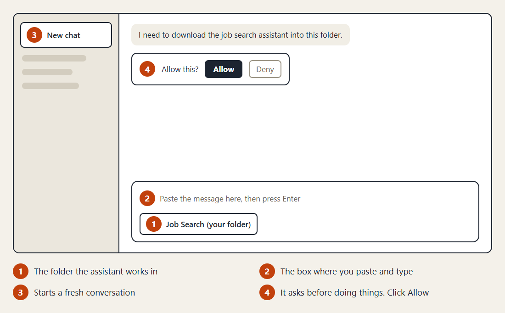

# Easy set-up: start here if you are not technical

This page gets the job search assistant working on your computer. You do not need to
know anything about computers beyond opening a program and copying and pasting.

**You will not type any code.** You install one program, copy two messages from this
page into it, and click **Allow** when it asks. The program does the rest.

**You cannot break anything by following this page.** If something looks wrong, there
is a [what to do if you get stuck](#if-you-get-stuck) section at the bottom.

## What you need

- A Windows or Mac computer. (These steps have been tried on Windows. A Mac follows
  the same steps but has been tried less.)
- A **ChatGPT** account or a **Claude** account. One is enough. If you already pay for
  one of them, use that one.
- Your CV as a file on this computer (PDF or Word).
- About an hour. Most of it is waiting while things download, and you can walk away
  during that.

**About cost.** A free ChatGPT account can start, but it runs out quickly. Most people
use a paid plan (ChatGPT Plus, or Claude Pro), which start at about US$20 a month.
Claude needs a paid plan for this. The job search assistant itself is free.

## What you will see

Both programs look roughly like this drawing. Yours will look a little different, but
the same four things are there.



---

## Step 1. Install the AI program

Pick **one** of these. Do not install both.

### If you use ChatGPT

1. Go to **[chatgpt.com/download](https://chatgpt.com/download/)**.
2. Click the black **Download** button and open the file it downloads (look in your
   **Downloads** folder). Say yes to whatever it asks, until ChatGPT opens.

   

3. Sign in with your ChatGPT account.
4. Near the top of the window there is a menu that says **ChatGPT**. Click it and
   choose **Codex**. (Codex is the part of ChatGPT that can do work on your computer.)

### If you use Claude

1. Go to **[claude.com/download](https://claude.com/download)**.
2. Click the black **Download** button on the left and open the file it downloads
   (look in your **Downloads** folder). Say yes to whatever it asks, until Claude opens.

   

3. Sign in with your Claude account.
4. At the top of the left-hand side, click **Code**. If it asks you to upgrade, you
   need a paid Claude plan before you can continue.

## Step 2. Make a folder called Job Search

This is where the assistant and all your applications will live.

- **Windows:** Open **File Explorer** (the yellow folder icon at the bottom of the
  screen). Click **Documents** on the left. Right-click an empty white area, choose
  **New**, then **Folder**. Type `Job Search` and press Enter.
- **Mac:** Open **Finder** (the smiling face icon). Click **Documents** on the left.
  In the menu at the very top of the screen, click **File**, then **New Folder**. Type
  `Job Search` and press Return.

## Step 3. Open that folder in the AI program

- **ChatGPT (Codex):** Click **Add new project**, then find **Documents**, click
  **Job Search** once, and click the button to open or select it.
- **Claude:** Under the box where you type, click the small folder button, choose
  **Open folder…**, find **Documents**, click **Job Search** once, and click the
  button to open or select it.

If it asks whether to trust or allow access to this folder, say **yes**.

You should now see the name **Job Search** somewhere near the box where you type
(number 1 in the drawing above).

## Step 4. Copy the first message and send it

Copy everything in the grey box below. (Move your mouse over the box and click the
small copy button that appears in its top-right corner. If you see no button, select
all the text in the box with your mouse and copy it.) Then click in the typing box in
the AI program, paste, and press Enter.

You do not need to understand what is in the box. It is written for the program.

```text
Set up the Job Search Agent Harness in this folder. I am not technical: do every step
you can yourself, and tell me in plain everyday words when I need to click or type
something. Never ask me to choose between technical options (pick the recommended
one), never ask me to open a terminal, and decline optional extras.

1. Download https://github.com/WilliamEbong/job-search-agent-harness so that its files
   sit directly in this folder, not in a subfolder. Use git if it is installed,
   otherwise the ZIP (on Windows, unblock the unpacked files). If this folder is not
   empty, delete nothing: download to a temporary folder and move everything here,
   including the hidden folders (.git, .claude, .agents).
2. Run `python harness_setup.py --yes --quick` here (`python3` on a Mac). If Python is
   missing, install it first.
3. Install anything it reports MISSING, then run it again. Use the command it prints;
   on a Mac, or where it prints none, use the standard installer or Homebrew. Repeat
   until nothing required is MISSING. Two exceptions are fine for now: rows that say
   RESTART SHELL, and a MISSING "Agent runtime" row (I am using the desktop app).
4. If something needs my computer password or a window I must click, tell me exactly
   what to do and wait for me.
5. When you are done, tell me in one short sentence that the download and install are
   finished and I can go on to step 6 of the easy set-up guide.
```

## Step 5. Click Allow while it works

The program now downloads the assistant and installs what it needs. This takes 10 to
40 minutes.

- It will stop several times and ask permission to download or install something.
  **Click Allow (or Approve, or Yes) every time.** This is normal and expected.
- Windows may show a separate window asking "Do you want to allow this app to make
  changes?" Click **Yes**. A Mac may ask for the password you use to log in to the
  computer. Type it.
- You will see a lot of text scroll past. You do not need to read it.
- You can leave it running and come back. If it is waiting for you, it will say so at
  the bottom.

It is finished when it tells you to go on to step 6.

## Step 6. Close the program and open it again

Close the AI program completely, then open it again. This lets it notice everything
that was just installed.

## Step 7. Start a new chat and send the second message

1. Click **New chat** (in Claude it may say **New** or **New session**).
2. Check that it still says **Job Search** near the typing box. If it does not, open
   the folder again as you did in step 3.
3. Copy the grey box below, paste it, and press Enter.

```text
I am not technical. First finish the install: run `python harness_setup.py --yes
--quick` (`python3` on a Mac). If anything required is still MISSING, install it
yourself and run it again, telling me in plain everyday words if I need to click
something. A MISSING "Agent runtime" row is fine: I am using the desktop app.

Then set me up in lite mode, and record lite mode in preferences.yaml. Decline every
optional extra. Never ask me to open a terminal, make another account or get a key.
Ask your questions in plain everyday words.
```

## Step 8. Answer its questions

It now asks you a few things. Type your answers in ordinary words. If it asks several
questions at once, you can answer them in one message.

- **Your CV.** Tell it where the file is, for example "it's in Downloads, called
  My CV.pdf". You can also paste the text of your CV.
- **A few questions about you**, such as where you can work and the lowest pay you
  would accept. If you are unsure about one, say "skip".
- **If it asks about internet access for job searches** (ChatGPT only), choose
  **"approve each search"**.

When it has finished, it shows you up to 20 kinds of job you are well suited for and
asks whether you want to remove any. If you are unsure, say "keep them all". You are
set up.

---

## After that, just talk to it

Open the AI program, make sure it says **Job Search**, and type any of these:

- "find me jobs"
- "apply to this", followed by a link to a job advert (or the number of a job from its
  list)
- "I applied", once you have sent an application
- "what should I do today?"

Its replies sometimes suggest short commands such as `/lite search`. You can ignore
those. The plain sentences above do the same thing.

**It never sends anything to an employer.** It writes your CV and cover letter and
saves them in **Documents → Job Search → documents → applications**. You read them,
and you send them yourself. After you say "I applied", that application moves into the
**applied** folder inside it.

### Prefer buttons to typing? (Windows only)

Once the steps above are done, there is also an app with buttons called **Candor**. In
your **Job Search** folder, double-click **Install Candor**. A black window opens and
asks a few yes-or-no questions: press Enter for each one. After that, open it with the
**Candor** icon on your Desktop. If Candor says it cannot find an AI assistant, paste
that message into the AI program and ask it to fix it.

On a Mac there is no installer yet. Run `python3 harness_setup.py` once, then
double-click **Candor.command** in the folder; the README's app section has the details.


The names on that screen belong to a made-up example person, not a real one.

---

## If you get stuck

Nothing here can harm your computer, and you can always start a step again.

- **Ask the program itself.** It can see what went wrong. Paste this:

  ```text
  I am following the easy set-up guide (START-HERE-EASY-SETUP.md) and I am stuck.
  Look at what has happened so far, tell me in plain everyday words what went wrong,
  and fix it yourself if you can. If I must do something, give me one step at a time.
  ```

- **You cannot find a button this page mentions.** These programs change their look
  often. Type this into the program: "How do I open a folder on my computer in this
  app?" (or whatever you are looking for).
- **It says you have reached a limit.** Your plan has run out of use for now. Wait
  until the time it shows, then open the same chat and type "continue".
- **It seems to have stopped.** Scroll to the bottom. If there is an **Allow** button,
  click it. If not, type "continue".
- **Still stuck.** Take a picture of the screen with your phone and send it to the
  person who gave you this page.

## Is this safe?

- Your CV and applications stay in the **Job Search** folder on your own computer.
  There is no website holding them.
- The AI program (ChatGPT or Claude) reads them in order to help you, the same as when
  you paste something into a chat with it.
- Nothing is ever sent to an employer for you.
- To remove your CV, your applications and the assistant, delete the **Job Search**
  folder. The helper programs that were installed along the way stay on the computer.
  They are ordinary free programs and do no harm.

Comfortable with a terminal? The shorter technical instructions are in the
[README](README.md#prefer-a-terminal-or-chat).
